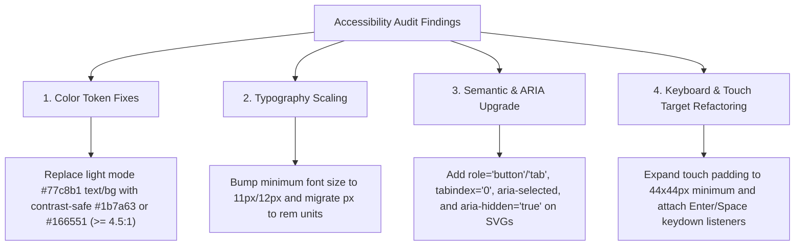

# GetSociable · Accessibility (WCAG 2.1 AA) Audit Report

> **Historical snapshot** (commit `73e7157`). Current rules: [`design-system/accessibility.md`](design-system/accessibility.md). Current findings: run `node tools/audit-runtime.js` and `node design-eval.js`.

**Target File:** `index.html` (Latest commit `73e7157` on `main`)  
**Scope:** All 41 prototype screen views, global topbar, side decision matrix, right rail, light/dark themes, typography, color contrast, keyboard navigation, and screen-reader accessibility.  
**Standard Evaluated:** WCAG 2.1 Level AA Guidelines  

---

## 1. Executive Summary

An automated and structural accessibility audit was performed on `index.html` following the latest pull from `main`. `index.html` is a single-file design console and mobile application prototype containing **41 distinct screen views** (`scrHome`, `scrEvents`, `scrDetail`, `scrPlan`, `scrImportReview`, `scrHub`, `scrOnboard`, etc.) rendered dynamically within a phone frame wrapper.

### Overall Compliance Status: **Requires Key Improvements**
While the application displays strong dark mode contrast and modern structural layout, several critical accessibility regressions and semantic gaps exist that hinder screen reader users, keyboard navigation, and users with low vision.

| Audit Category | Status | Highlights & Issues |
| :--- | :--- | :--- |
| **Color Contrast (Light Mode)** | ⚠️ **FAIL (Critical)** | Primary accent mint (`#77c8b1`) on white background has a **1.97:1** ratio (WCAG AA min: 4.5:1). |
| **Color Contrast (Dark Mode)** | ✅ **PASS** | Primary text (`#f4f4f4`) on dark background (`#121215`) achieves a **17.0:1** ratio. |
| **Typography & Font Scaling** | ⚠️ **Needs Work** | **69 CSS declarations** use fonts below 11px (down to 8px). Hardcoded `px` prevents text zoom. |
| **Keyboard Nav & Semantics** | ❌ **FAIL** | Over **105 interactive UI elements** (tabs, chips, day cells, plus buttons) are `<div>`/`<span>` without `role` or `tabindex="0"`. |
| **Screen Reader / ARIA** | ❌ **FAIL** | Only 1 of 39 screen functions includes ARIA attributes. **47 SVG icons** lack `aria-hidden="true"`. |
| **Touch Target Size** | ⚠️ **Needs Work** | Interactive action buttons (`.plusbtn`, `.vi`, `.secadd`) are 26px–30px (below 44px min). |

---

## 2. What's Already Working

> [!NOTE]
> Below are the core design and architectural choices in `index.html` that meet or exceed accessibility guidelines.

1. **Dark Theme Text Contrast (WCAG 1.4.3)**
   - High contrast dark mode design tokens:
     - `--ink` (`#f4f4f4`) on `--bg` (`#121215`): **17.00:1 contrast ratio** (Exceeds AAA).
     - `--ink-2` (`#a2a2a8`) on `--surface` (`#212127`): **6.31:1 contrast ratio** (Passes AA).
     - Mint Accent (`#77c8b1`) on Dark `--bg` (`#121215`): **9.51:1 contrast ratio** (Passes AA).
2. **Primary Light Mode Typography (WCAG 1.4.3)**
   - Main body text (`#1a1a1a`) on white background (`#ffffff`): **17.40:1 contrast ratio** (Exceeds AAA).
   - Secondary text (`#5c5c5c`) on white background: **6.69:1 contrast ratio** (Passes AA).
3. **Top Bar Console Focus Rings (WCAG 2.4.7)**
   - Native `<button>` elements in `.topbar` use explicit outline styling:
     ```css
     .tbtn:focus-visible { outline: 2px solid #77c8b1; outline-offset: 2px; }
     ```
4. **Font Stack & Performance (WCAG 1.4.12)**
   - Clean Google Fonts integration using `family=Poppins:wght@400;500;600;700&family=Inter:wght@400;500;600;700&display=swap`.
5. **Heading Structure on Core Screens (WCAG 1.3.1)**
   - 27 of 39 screen functions feature semantic `<h1>`, `<h2>`, or `<h3>` tags for screen section titles (e.g. `.nowhead h1`, `.titlerow h2`, `.bcard h3`).

---

## 3. Areas Needing Improvement

### 3.1 Color Contrast Violations (WCAG 1.4.3 & 1.4.11)

> [!CAUTION]
> **Critical Contrast Regression (`#77c8b1` Mint Accent):**  
> In commit `73e7157`, `--free` and `--accent` were updated from `#2f7d68` (4.64:1 ratio) to `#77c8b1`. On light backgrounds, `#77c8b1` drops contrast to **1.97:1**, causing severe legibility failures for visually impaired users.

| Element / Selector | Foreground | Background | Computed Ratio | Requirement | Status |
| :--- | :--- | :--- | :--- | :--- | :--- |
| `.tbtn.accent.on` (Text) | `#ffffff` | `#77c8b1` | **1.97:1** | 4.5:1 (Normal Text) | ❌ **FAIL** |
| `.plusbtn.added` (Icon) | `#ffffff` | `#77c8b1` | **1.97:1** | 3.0:1 (UI Component) | ❌ **FAIL** |
| `.itemstatus .booked` | `#77c8b1` | `#ffffff` | **1.97:1** | 4.5:1 (Normal Text) | ❌ **FAIL** |
| Navigation Sublabel (`.navlbl`) | `#9a9aa6` | `#ffffff` | **2.78:1** | 4.5:1 (Normal Text) | ❌ **FAIL** |
| Badge Parked (`.badge.parked`) | `#93650f` | `#faedd4` | **4.41:1** | 4.5:1 (Small Text) | ⚠️ Borderline |
| When Tag (`.when-tag`) | `#3a72a8` | `#e4eef9` | **4.31:1** | 4.5:1 (Small Text) | ⚠️ Borderline |

---

### 3.2 Typography & Micro-Font Scaling (WCAG 1.4.4)

> [!WARNING]
> There are **69 CSS declarations** specifying font sizes smaller than **11px** (ranging from 8px to 10.5px).

- **8px font sizes:** `.when-tag`, `.soonpill`, `.logrow .ls`, `.unwired-tag`, `.tag`
- **8.5px font sizes:** `.badge` (decision status pills)
- **9px font sizes:** `.navlbl`, `.logo .g`, carousel arrows
- **9.5px font sizes:** `.scarce`, `.why .wl`, `.sbtn`, `.keys`, `.agenda-caption .ac-kicker`
- **Impact:** Text smaller than 11px is unreadable on standard mobile screens without pinching/zooming. Fixed `px` font units prevent users from using browser-level font resizing.

---

### 3.3 Keyboard Navigation & Interactive Semantics (WCAG 2.1.1 & 4.1.2)

- **Div-based Interactive Components:** Over **105 interactive elements** inside the mobile frame use `<div>` or `<span>` tags with `cursor: pointer`, but lack keyboard accessibility:
  - Navigation Tabs (`.tab`, `.ptabs span`, `.viewtabs .vt`)
  - Segment Controls (`.seg > span`)
  - Filter Chips (`.chip`, `.obchip`, `.fchip`)
  - Action Items (`.plusbtn`, `.daycell`, `.citypill`, `.famhead`, `.grp`, `.hbtn`, `.cbtn`)
- **Consequences:**
  - Keyboard-only users (navigating via `Tab`) cannot focus or activate these controls.
  - Screen readers register these elements as plain static text rather than buttons or tabs.
  - Missing state attributes: Active tabs do not expose `aria-selected="true"`, and toggles lack `aria-pressed="true"`.

---

### 3.4 Screen Reader Compatibility & SVG Icons (WCAG 1.1.1 & 2.4.3)

- **47 Decorative SVG Icons:** Lacks `aria-hidden="true"`. Screen readers attempt to read inline `<path>` strings or omit icon context.
- **Dynamic View Navigation:** When a user clicks a tab (e.g., switching from *Home* to *Detail*, *Plans*, or *Import Review*), focus remains on the clicked tab rather than transferring to the screen heading. Screen readers fail to announce the new screen content.
- **12 Screen Builders Without Headings:** Screens like `scrDatePicker`, `scrInterestPrompts`, `scrFilter`, and `scrLocationApp` lack an `<h1>`-`<h3>` structure.

---

### 3.5 Touch Target Sizing (WCAG 2.5.5 & 2.5.8)

- WCAG guidelines recommend a minimum touch target area of **44x44px** (or 48x48px on mobile).
- Several interactive buttons in the mobile frame are under sized:
  - `.plusbtn`: 28x28px (Target too small)
  - `.vi` / `.vi2`: 26x26px to 30x30px
  - `.secadd`: 28x28px
  - `.badge.collapse`: 8.5px badges acting as accordion toggle targets.

---

## 4. Remediation Recommendations



### Specific Code Fix Recommendations:

1. **Light Mode Accent Token Adjustment:**
   ```css
   /* In index.html CSS tokens */
   :root {
     --accent-text: #1b7a63; /* 4.56:1 contrast on white */
     --accent-bg: #e6f5ef;   /* Soft background */
   }
   ```
2. **Keyboard Accessible Interactive Component Pattern:**
   ```html
   <!-- Before: plain non-focusable div -->
   <div class="chip" onclick="selectChip()">Filter</div>

   <!-- After: accessible keyboard-enabled button -->
   <div class="chip" role="button" tabindex="0" aria-pressed="false" onclick="selectChip()" onkeydown="if(event.key==='Enter'||event.key===' ') selectChip()">Filter</div>
   ```
3. **SVG Icon Hiding:**
   ```html
   <svg aria-hidden="true" focusable="false" viewBox="0 0 24 24">...</svg>
   ```

---

*Report generated automatically for `getSociable` repository (`index.html`).*
